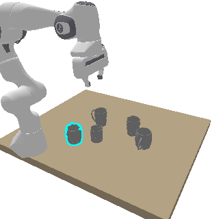
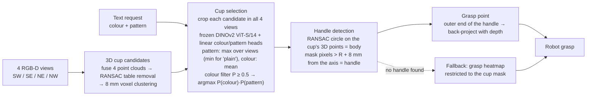
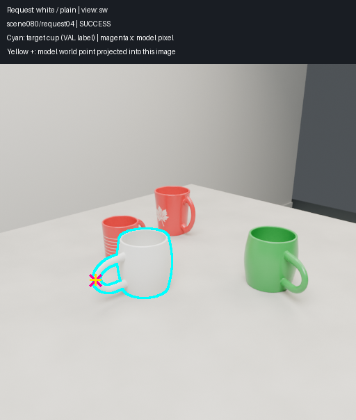
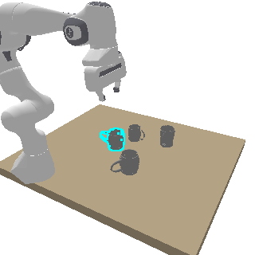

# Multi-view RGB-D Cup Picking

Find the cup a text request asks for ("blue leaf-pattern cup") in four RGB-D views and give a robot a point to grasp. A course team project. In simulation, it raised pick success from **51.8%** (provided baseline) to **88.5%** with the model in this repo, and to **89.6%** with an added CLIP pattern head (weights not included, see [Results](#results)).

| Provided baseline: lifts a different green cup | This project: lifts the requested cup |
|---|---|
|  |  |

*"Pick up the green cup with a bird pattern."* Validation scene 064, request 04 (L3, occlusion), course simulator. The bird pattern is hidden from the SW camera, and the table holds another green cup. The cyan outline marks the target for the viewer only; the model never receives it.

## Task

| | |
|---|---|
| Input | RGB, depth, intrinsics and camera pose from 4 fixed cameras (SW, SE, NE, NW). A request with colour (6) and pattern (5: plain, flower, bird, leaf, stripes) |
| Output | `PICK` with a world-space grasp point (plus view and pixel), or `NO_PICK` |
| Scoring | A course-provided PyBullet robot executes the grasp. Success = the requested cup is lifted ≥ 10 cm and held ≥ 1 s. Lifting another cup counts as failure |
| Data | Validation set of 546 requests in 3 levels: L1 basic (280), L2 same-colour distractors (216), L3 occlusion (50). The test set is private. Validation cup shapes and pattern artwork do not appear in training |

## Pipeline



Nothing in the pipeline uses labels at inference time. The only trained parts are two linear heads on frozen DINOv2 features and a heatmap network kept as a fallback, all trained on the training split. Handle detection uses geometry only.

## How It Works

| Step | What happens | Key settings | Trained? |
|---|---|---|---|
| 1. Cup candidates | Back-project every valid depth pixel of the 4 views into one world point cloud. Fit the table with RANSAC over near-horizontal planes and keep points 6 mm–20 cm above it. Group them by 26-connected 8 mm voxels. Each cluster gets a mask in every view | Plane tilt ≤ 15°, inlier 4 mm. Clusters kept if ≥ 200 points, ≤ 20 cm wide, ≥ 3 cm tall | No |
| 2. Crops | Crop each candidate from each view where its mask has ≥ 150 px. Pixels outside the mask are grey so neighbouring cups do not leak in | Square box + 10% margin, resized to 224×224 | No |
| 3. Features | Frozen DINOv2 ViT-S/14 turns each crop into a 768-d vector (CLS token + mean patch token). The model is re-implemented in the file, so inference needs no downloads | – | No (frozen) |
| 4. Colour / pattern probabilities | **Linear head**: standardise the 768 features, apply one linear layer (W·x + b), then softmax. 6 colours: 6×768 weights + 6 biases. 5 patterns likewise. Colour accuracy on real candidate crops: 99.8% | Class-balanced cross-entropy, AdamW, training-split crops only | Heads only |
| 5. Multi-view fusion | Colour: mean over views. Pattern: **max** over views for a patterned request (one view showing it is enough), **min** for "plain" (every view must agree) | – | No |
| 6. Cup choice | Keep candidates with P(colour) ≥ 0.5, then take the single best P(colour)·P(pattern) | Top-1 only | No |
| 7. Handle | RANSAC circle on the chosen cup's 3D points (z > 2 cm) gives body centre c and radius R. Mask pixels farther than R + 8 mm from c are the handle. Use SW if it shows ≥ 30 handle pixels, otherwise the view with most | Radius 2.5–7.5 cm, inlier 3 mm | No |
| 8. Grasp point | Median of the outermost 10% of handle pixels, snapped to the nearest handle pixel with valid depth inside the robot workspace, then back-projected to 3D | – | No |
| 9. Fallback | No handle found: the heatmap network, restricted to the cup mask. No candidate passes the colour filter (e.g. two touching cups merged): the heatmap network on all 4 views. On validation this ran 6 times out of 546, all successful | Baseline CNN architecture, retrained on 4 views | Yes |

The robot side is provided by the course and was not changed. It turns the grasp point into a gripper pose (radial approach, 8 cm opening), executes it, and scores the result.

## Results

Validation, 546 requests, simulated robot.

| Model | L1 | L2 | L3 | **All** |
|---|---|---|---|---|
| Provided baseline (SW view, small CNN heatmap) | 59.6% | 46.8% | 30.0% | **51.8%** (283) |
| This repo (DINOv2 selection + geometric handle grasp) | 91.4% | 86.1% | 82.0% | **88.5%** (483) |
| + CLIP pattern head (weights not in this repo) | 92.1% | 86.1% | 90.0% | **89.6%** (489) |

The CLIP pattern head is the same pipeline with one change. The pattern head reads frozen CLIP ViT-B/16 features (512-d) concatenated with the DINOv2 features (768-d). Compared request by request with the repo model, it fixed 6 requests and broke none (McNemar p = 0.031). This gain is small and borderline, and several of the 6 requests come from near-identical scenes. It is reported as a robustness improvement for unseen pattern designs, not as a clear accuracy gain. Its weights (434 MB, mostly the CLIP image encoder) are over GitHub's file limit, so they are not included.

| Component | Measurement | Before → After |
|---|---|---|
| Multi-view score fusion | Cup-selection accuracy (offline, no robot) | 90.5% → 96.2% |
| Geometric handle grasp | Grasp failures on the robot, same runtime | 83 → 50 (McNemar p < 1e-5) |
| CLIP + DINOv2 pattern features | Balanced pattern accuracy on unseen pattern designs (offline) | 85.3% → 91.7% |
| CLIP + DINOv2 pattern features | Robot success, same requests | 88.5% → 89.6% (6 fixed, 0 broken) |

## Experiment Log

In order. Robot success rate on the 546 validation requests unless noted. Dead ends are included.

| # | Change | Result | Why the next step |
|---|---|---|---|
| 0 | Provided baseline: SW view only, 6-layer CNN heatmap | 51.8% | 73% of failures pointed at a **different cup**. Finding the right cup comes first |
| 1 | Retrain the baseline CNN on all 4 views and pick the most "observable" view | 59.2%. Gain on L1 only | View choice did not work: the score gap between views averaged 0.03. All 139 wrong-cup lifts were *same colour, different pattern* |
| 2 | Add a view one-hot to the input | **Stopped before running** | It addresses neither pattern recognition nor view selection |
| 3 | Diagnostic: frozen DINOv2 + linear head on ground-truth cup crops (oracle) | Picks the right cup 98.7% vs 51.3% for (1) on L2 | Patterns are separable with good features. The bottleneck is the model, not the data |
| 4 | Label-free 3D candidates from depth + DINOv2 selection | L2: 48.1% → 76.9% | Candidate segmentation loses almost nothing vs ground-truth crops |
| 5 | Colour filter before ranking | Selection 88.3% → 90.5% | Without it, a different-colour cup showing the pattern could win |
| 6 | Integrate (4)+(5) as a submission | 77.8% | Remaining wrong-cup cases: 33 of 42 had the pattern hidden from the SW view |
| 7 | Fuse scores over the 4 views (max for patterns, min for "plain") | Selection 90.5% → 96.2%. Robot 82.2% | Largest remaining failure: picking the right cup but failing the grasp |
| 8 | Diagnostic: grasp exactly at the labelled reference point (oracle) | 93.3% vs 82.8% on the same 478 requests | Better grasp points alone could gain ~10 points. Earlier analysis: handle grasps 92% vs body grasps 46% success |
| 9 | Diagnostic: find the handle from depth geometry (no robot) | Grasp point on the handle 85% → 99% | |
| 10 | Keep the chosen cup when its grasp point is invalid (instead of the 2nd-ranked cup) | 83.0% | **No measurable effect** |
| 11 | Grasp the outer end of the geometrically detected handle | **88.5%**. Grasp failures 83 → 50, p < 1e-5 | Remaining failures: 15 wrong cup, 48 handle grasps that fail even at the reference point |
| 12 | CLIP for unseen pattern designs (offline) | CLIP zero-shot **worse** (82.1%). CLIP + linear alone **no gain**. CLIP + DINOv2 85.3% → 91.7% | Of the 15 remaining wrong-cup failures in (11), 6 were pattern misreads |
| 13 | CLIP + DINOv2 head on real candidates (offline) | Selection 96.2% → 97.3% (6 fixed, 0 broken) | About +1 point expected on the robot |
| 14 | (11) + (13) on the robot | **89.6%**. 6 fixed, 0 broken (p = 0.031), matching the offline prediction | Remaining: 48 failed handle grasps, most of which also fail at the labelled reference point (grasp pose / cup shape). 9 wrong-cup lifts, mostly cases where the target cup merged with a neighbour and is missing from the candidates |

## Failure Analysis: body grasps instead of handle grasps

1. **Finding the failure.** After cup selection was fixed (step 7), most remaining failures were *right cup, failed grasp*. Splitting the robot outcomes by the part of the cup that was grasped (diagnosis only, using part labels) gave clear numbers. Handle grasps succeeded 92.1% of the time and body grasps 45.7%. The provided grasp policy approaches radially with an 8 cm opening, which suits a handle.
2. **Checking the ceiling first.** Before changing anything, the robot was scored on the labelled handle reference point (step 8): 93.3% vs 82.8%. This showed that a better grasp point would pay off.
3. **Fix without training.** A cup body is a cylinder. A RANSAC circle fitted to the cup's 3D points from all four views gives the body axis and radius. Mask pixels more than 8 mm outside the circle are the handle. The 8 mm margin is the smallest margin with 100% handle precision on the training split. The grasp pixel is the median of the outermost 10% of handle pixels.
4. **Result.** Grasp failures fell from 83 to 50 in the same runtime. Only 8 requests got worse (38 fixed vs 8 broken, McNemar p ≈ 9e-6).
5. **What is left.** In 48 of the remaining 50 grasp failures the grasp pixel is already on the handle, a median of 4.5 px from the reference point. The oracle reference grasp also fails on 34 of them. So these are limits of the grasp pose and the cup shape, not of perception. One cup shape accounts for 28 of them.

Same request, same chosen cup, only the grasp point differs. *"Pick up the plain white cup."* Validation scene 080, request 04.

| Before: heatmap grasp lands where handle meets body → `pick_failed` | After: outer end of the geometric handle → success |
|---|---|
|  |  |
|  |  |

The magenta × is the predicted pixel. The cyan outline is the validation label, drawn for the viewer only.

## My Contribution

This README covers my part of a course team project.

My work:
- Analysed the baseline's failure modes and chose each next experiment from them (log above)
- Built the label-free 3D candidate pipeline (point-cloud fusion, RANSAC table removal, voxel clustering)
- Built cup selection with frozen DINOv2 and linear heads, multi-view score fusion and the colour filter, and wrote a self-contained DINOv2 implementation so inference needs no downloads
- Ran the oracle diagnostics (ground-truth crops, reference-point grasps) to measure each part's ceiling before building it
- Designed and evaluated the geometric handle detection and grasp
- Ran the CLIP generalisation study
- Evaluated with paired statistics (McNemar, Wilson intervals) on the same requests

**AI assistance.** I developed this project with an AI coding assistant (Claude Code). It helped write code and run analyses. The direction of the work, the experiments to run and the decisions taken from the results were mine.

## Limitations

- **Simulation only.** All numbers come from the course PyBullet simulator. Nothing was tested on a real robot or on real camera noise.
- **Validation only.** The test set is private, so there are no test numbers. Several design choices were made after looking at validation results, so validation numbers may be optimistic.
- **Effective sample size.** 546 requests, but many scenes repeat nearly the same layout. Re-scoring identical predictions locally vs on Colab changed 18 of 546 outcomes, so differences of 1–2 points are within simulator noise.
- **Handle rule.** The rule assumes an upright cylindrical body with a protruding handle. One cup shape still fails often even with ideal grasp points.
- **Not standalone.** The code needs the course environment: robot simulator, data loaders, the baseline network definition and the dataset. None of these are redistributed here.

## How to Run

Requirements:
- The course project folder (`baseline.ipynb`, `common/`, `robot/`, `robot_world/`, dataset) and its `requirements.txt` (PyTorch, NumPy, Pillow, PyBullet)
- No internet access is needed at inference

`cup_picking.py` contains only this project's code. At import, it loads the course-provided definitions (baseline network, coordinate helpers) from the course `baseline.ipynb`.

```bash
export CAFE_COURSE_DIR=/path/to/course/cafe_project   # folder with baseline.ipynb, common/, dataset/
```

Predict one validation request:

```python
import os, sys
sys.path.insert(0, os.environ["CAFE_COURSE_DIR"])
from common.catalog import samples
from common.public_io import load_observations
from cup_picking import Predictor

data = os.path.join(os.environ["CAFE_COURSE_DIR"], "dataset")
predictor = Predictor("weights/cup_picking.pth", device="cpu")
row = samples(3, "val", data)[0]
print(predictor.predict(load_observations(row, data), row["request"]))
```

Full validation run with the course evaluator (prediction, then robot scoring):

```python
from common.validation import evaluate_predictions, evaluate_saved_picking
prediction_dir, table = evaluate_predictions(predictor, max_level=3, data_root=data, views=("sw", "se", "ne", "nw"),
                                             model_name="cup_picking", output_root="runs", checkpoint="weights/cup_picking.pth")
print(evaluate_saved_picking(prediction_dir, data_root=data, robot_workers=2))
```

`weights/cup_picking.pth` (89 MB) bundles:
- DINOv2 ViT-S/14 weights (Meta, Apache-2.0)
- the two linear heads
- the fallback heatmap network: the course baseline architecture, retrained by us on four views
